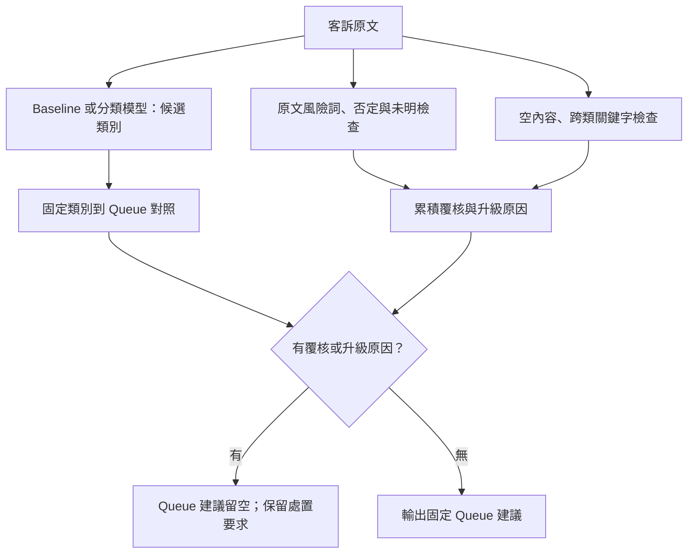

# CS02｜分類器答對更多題，為什麼仍會派錯單位？

**L3 · Engineering Deep Dive**

**研究範圍：** 48 筆繁中合成客訴；28 筆訓練、12 筆單類測試、8 筆診斷。研究比較固定關鍵字 Baseline 與 TF-IDF＋Logistic Regression，沒有真實派工。

**狀態：** 既有研究整理；Human Final Acceptance PENDING。本文沒有新增實驗、重跑測試或獨立驗證。

## 研究發現｜先看結果

| 觀察 | 保存結果 |
| --- | --- |
| 模型答對更多單類測試 | 模型 9/12；Baseline 1/12 |
| 合法 Queue 仍可能派錯 | TEST-DELIVERY-33 被派至 QUEUE_RETURN |
| 零特徵控制只攔部分錯誤 | TEST-DEFECT-38/39 轉覆核，D06/D08 未攔住 |
| 23 項控制測試通過 | 只證明指定風險與格式情境，不代表語意派工可靠 |

## 01｜分類器到底學到了什麼？

｜分類器究竟根據什麼做判斷？

### 實作條件

| 項目 | 本次固定設定 |
| --- | --- |
| 訓練／單類測試／診斷 | 28／12／8 筆合成文字 |
| 類別 | payment、delivery、return、defect；train 各 7 筆 |
| 特徵 | 字元 TF-IDF，2–4 gram，最多 10,000 項 |
| 分類器 | Logistic Regression；C=1、max_iter=1000、seed=42 |
| 訓練紀錄 | fit 一次，無警告；實際學得 1,268 項詞彙 |
| 執行環境 | Python 3.13.6、scikit-learn 1.9.1 |

只在 train 資料上 fit TF-IDF 與分類器；測試文字以已學詞彙 transform。分類器在四個既有類別中選最高分，**沒有內建「不屬於四類」的選項**。分類分數不是經過校準的正確機率，也未用分數門檻決定覆核。

### 觀察 A｜高權重特徵不一定代表業務理解

保存的模型係數中，payment 的正權重包含「付款」，delivery 包含「包裹」，return 包含「退貨」；但 defect 的高正權重還包含「，商」「，商品」「品有瑕疵」。

**Observed：** 分類器確實利用這些與訓練類別相關的字元片段。  
**Interpretation：** 表面寫法可能成為分類依據；這不等於模型學會可遷移的業務概念。係數本身不能證明哪個特徵造成某一筆預測。

### 觀察 B｜答對的 TEST-PAYMENT-29，證據其實很薄弱

這筆文字描述「分三期卻一次收取全部金額」。關鍵字 Baseline 沒有命中；模型正確選擇 payment。但保存詞彙檢視顯示，該輸入只命中「嗎？」與「金額」。

| 候選類別 | 保存分數（約） |
| --- | ---: |
| payment | 0.2643 |
| return | 0.2618 |

**Observed：** 這筆分類正確，且兩類分數接近。  
**Not established：** 不能據此認定模型理解分期付款，或把分數解讀成正確機率。

## 02｜合法 Queue 為什麼仍然派錯？

｜合法 Queue，為什麼仍然可能派錯？

### 候選分類與實際控制是兩條不同判斷路徑

固定對照為 `payment → QUEUE_PAYMENT`、`delivery → QUEUE_DELIVERY`、`return → QUEUE_RETURN`、`defect → QUEUE_QUALITY`。候選自行填寫的 `queue`、`claimed_status` 或 `escalation` 不具決策權威。

**控制可強制 Queue 來自允許清單，但不會自動驗證候選類別是否語意正確。**

### 失敗案例｜TEST-DELIVERY-33

客戶反映兩箱只到一箱。保存詞彙只命中「訂單」「，我」；模型最高候選為 return（約 0.2590），payment 約 0.2586。程式因此產生 `QUEUE_RETURN`。

| 檢查點 | 實際結果 |
| --- | --- |
| 業務問題 | 配送缺件 |
| 模型候選 | return |
| 固定對照 | `QUEUE_RETURN` |
| 是否有其他覆核原因 | 無 |
| 最終輸出 | **合法但錯誤的 Queue 建議** |

**Observed：** 固定對照沒有阻止這筆錯誤建議。  
**Engineering implication：** 「輸出格式／Queue 合法」與「分類內容正確」必須分開驗證。

## 03｜有特徵，為什麼不代表有足夠資訊？

｜為什麼 zero_features 能攔住部分錯誤，卻攔不住 D06／D08？

### 成功攔截｜TEST-DEFECT-38／39

耳機斷線與按鍵卡住兩筆文字完全沒有命中已學詞彙，留下 `zero_features` 訊號。模型仍選 payment，且兩筆分數相同；零向量下主要由截距決定輸出，是與結果相符的機制解釋。

**Observed：** 雖然候選分類錯誤，控制程式將兩筆轉為覆核，沒有輸出一般 Queue 建議。

### 未攔截｜D06／D08

| 診斷案例 | 命中的保存詞彙 | 模型候選 | 控制結果 |
| --- | --- | --- | --- |
| D06：徵兼職 | 「沒有」「請問」 | delivery | 仍給 Queue |
| D08：資訊不足 | 「幫我」 | payment | 仍給 Queue |

兩筆都不是零向量，也未觸發既有風險或關鍵字衝突規則，因此沒有被轉覆核。

**Observed：** `zero_features` 只能辨識「完全沒有已學片段」，不能辨識「有片段但不足以支持分類」。  
**Not tested：** 尚未驗證何種資訊充足度檢查、域外偵測或拒答方法能改善此問題；不能在已曝光的 20 筆結果上事後挑門檻，便宣稱修復成功。

## 04｜23 項測試全過，為什麼仍會錯？

｜23 項控制測試通過，為什麼仍有錯誤？

### 測試實際涵蓋的範圍

- **15 項：** 3 段明確風險文字 × 5 種候選類別，檢查風險命中後不被錯誤分類降級。
- **另外 8 項：** 否定風險、未知類別、缺少對照、不合法 Queue、偽造候選權威、多主題、空內容、指令文字不能取消升級。

風險規則直接讀取原文，搜尋「起火、冒煙、受傷」；命中位置前最多 8 字內若出現指定否定／未明標記，列為不確定。明確命中優先 `ESCALATE`；否則不確定命中為 `REVIEW`；皆無為 `NO_RULE_HIT`。`NO_RULE_HIT` **不代表安全**。

### 實際控制案例｜D03

D03 描述杯口破裂造成人身受傷。模型雖錯分為 payment，原文風險檢查仍保留 `ESCALATE`，一般 Queue 留空。

**Observed：** 對指定風險詞，升級要求不依賴模型是否正確分類。  
**Limit：** 這只能支持「已命中時不降級」，不能證明所有應升級的語句都會被辨識。否定範圍、同義說法、引述與複雜歧義未得到全面驗證。

### 為什麼 23 項全過不等於全面可靠？

這 23 項沒有把域外偵測或資訊充足度設成通過條件。因此，**23 項指定測試通過**與 **D06／D08 仍被錯誤派 Queue** 可以同時成立。

這是工程測試覆蓋範圍的限制，不應將通過數字擴寫成整體安全保證。

## 05｜哪些結果能重建，哪些不能原樣重播？

｜哪些結果可以重現，哪些只能追溯？

### 資料與執行隔離

48 筆合成文字分為 28 筆 train、12 筆單類 test、8 筆診斷。執行器只對 train fit，先將兩種方法的候選及控制輸出寫入 `predictions.json`，**再載入評估標籤計分**。這避免模型在指定執行路徑中直接使用評估答案；但作者已看過所有合成文字，並非盲測。

既有資料檢查未發現跨集合的 family 或正規化文字重複，**不等於已證明語意獨立**。原始設定、結果與 manifest 留存可供一致性核對，但同一帳號仍可修改來源及基準。

### 模型產物的可重播限制

保存的詞彙、係數及執行紀錄足以檢視部分模型行為，但沒有完整 TF-IDF IDF 向量或可直接載入的 Pipeline。

- **可以：** 閱讀原次保存預測、核對結果，依資料與設定另行重建訓練。
- **不能直接做到：** 僅靠目前模型檢視檔，完整重播原次推論。
- **本次未做：** 為補齊產物而重新 fit。

### 效能數字的適用邊界

| 原次保存測量 | 約略數值 |
| --- | ---: |
| 模型 fit | 0.03075 秒 |
| Baseline：20 筆含控制的預測總計 | 1.075 毫秒 |
| 模型：20 筆含控制的預測總計 | 17.657 毫秒 |
| 訓練、預測、評估整段 | 0.09649 秒 |

這些是單次小量本機測量，**不是服務延遲、容量或 ROI 基準**；記憶體、電力、人力及實際營運成本未知。

## 結語｜這輪研究能支持什麼？

分類正確、Queue 合法與應否人工覆核是不同判斷。這輪保留了模型勝過關鍵字 Baseline 的結果，也保留合法但錯誤的 Queue 及域外案例。未測真實派工、完整語意驗證或部署。

## 研究資料與公開範圍

本文僅整理原研究的保存結果與案例。原始資料、程式、測試輸出、逐筆紀錄與版本證據留在本機，**L4 不公開**；因此網站可閱讀研究設計與主要結果，但無法單憑本頁完整重現實驗。原研究的證據紀錄仍可供內部追溯。**Human Final Acceptance PENDING。**