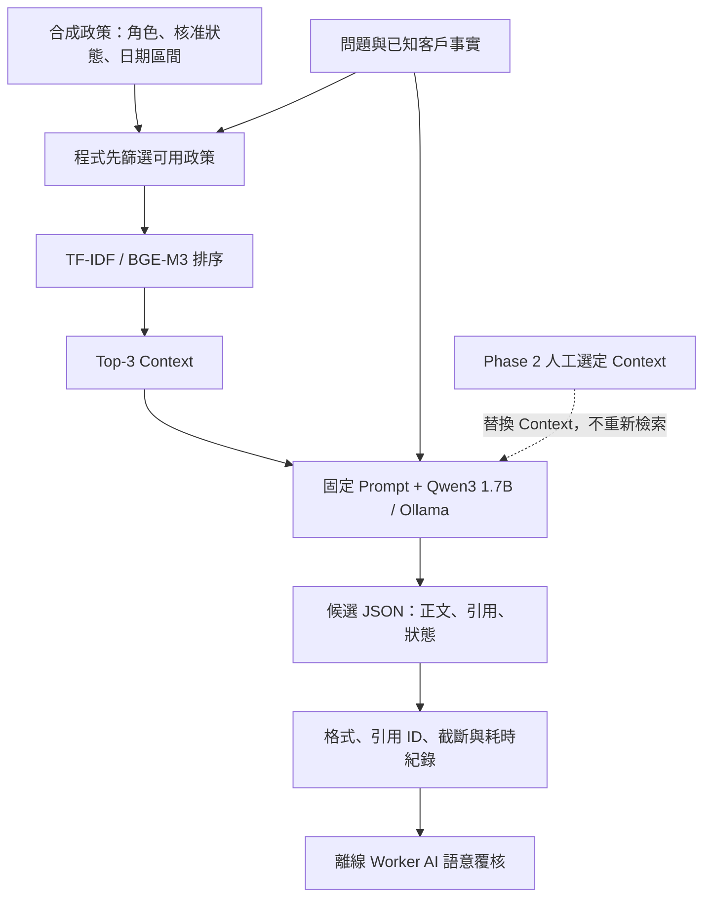

# CS07｜Engineering Investigations：正確政策為何仍產生錯誤回答？

> **研究狀態：** Research Closed · Worker AI Review · Human Acceptance PENDING  
> **內容性質：** 根據既有 Engineering Deep Dive 整理的網站 L3 技術深讀；未新增實驗、重跑推論或獨立驗證。  
> **研究邊界：** 13 份合成政策文件、24 題政策問答；本機離線研究，未接真實客戶、訂單、退款或客服系統。  
> **證據說明：** 下文相對路徑沿用原研究專案；網站需將其映射至可存取的 L4 證據，未發布的檔案不可假裝已有公開連結。

## Engineering Map｜從政策到候選回答

**實作邊界。** 政策按原有 section 切分，保留 ID、標題與原文；程式先依角色、approved 與適用日期篩選，再排序 Top-3。已知日期才套用對應日期區間；日期未知時保留可能版本。模型負責套用政策、產生正文、引用與 `ANSWER / CLARIFY / REVIEW`。程式紀錄格式與引用 ID，但沒有能阻擋錯誤政策主張交付的語意 Gate。研究沒有自動對客戶發布回答。

**固定條件。** 比較檢索方法時使用相同片段、篩選、Prompt 與 Qwen3；BGE-M3 使用 dense 向量及餘弦相似度，未使用其全部能力，也沒有向量資料庫。模型版本由保存的 digest 識別；沒有證據支持此模型或架構為最優選型。

**原始工程來源：** `src/baseline.py` · `src/run_round2.py` · `ENVIRONMENT.md` · `ROUND2_PLAN.md`

---

## Investigation 01｜檢索改善了，為何答案沒有跟上？

**Engineering question.** 取回更多必要證據，是否足以改善生成答案？

| 檢索方法 | 必要證據 Recall@3 |
| --- | ---: |
| TF-IDF | 92.5% |
| BGE-M3 | 97.5% |

**Observed｜已觀察。** 在相同生成條件下，BGE-M3 提高了必要證據 Recall@3，但模型仍會引用十四日政策卻回答七日，或拿到配送政策卻回答退貨。Q16／BGE 另發生輸出截斷，留下不完整 JSON；研究將其列為 Execution Failure，沒有補跑或補寫答案。

**Interpretation｜有限推論。** Retrieval 與 Generation 必須分開評估。較高 Recall@3 證明這批測試中必要證據更常進入 Top-3，不證明模型正確使用了證據，也不代表端到端客服成功率。

**Not established｜尚未證明。** 不能由此推論所有 Embedding 方法無效、檢索已達生產標準，或模型更換必然改善結果。

**Evidence：** `ROUND1_RESULTS.md` · `ROUND2_RESULTS.md` · `ROUND2_SEMANTIC_REVIEW.md`

---

## Investigation 02｜Prompt 更詳細，究竟改善了什麼？

**Experiment.** Round 3 Phase 1 使用保存的 48 份 Context，同期比較原始 P0 與通用改良 P1。P1 加強問題對準、條件保留，以及狀態與正文協調；沒有針對特定題號植入答案。

| 指標 | P0 | P1 |
| --- | ---: | ---: |
| Strict joint | 3/48 | 7/48 |

**Observed｜已觀察。** 新增成功集中在適當停止的案例；「正文正確且有支持」沒有增加。P1 Prompt 較長，請求成本也上升。

**Interpretation｜有限推論。** 更詳細的指令對特定停止行為有局部幫助，但不能將 strict joint 的變化解讀為整體生成可靠性已改善；也沒有證據足以自動以 P1 取代 P0。

**Not established｜尚未證明。** 未證明增加 Prompt 長度可持續改善政策套用，亦未建立成本效益。

**Evidence：** `ROUND3_PHASE1_RESULTS.md` · `expected/round2-system-prompt.txt`

---

## Investigation 03｜只留下正確 Context，模型仍會用錯期限

**Experiment.** Round 3 Phase 2 回到 P0，將原 Top-3 與事前人工選定的完整政策候選比較；另觀察順序、噪音與相同 Payload 重複執行。這是 **Oracle 診斷**，不是已建成的自動 Context Selection。

| Phase 2 結果 | 保存結果 |
| --- | ---: |
| 嘗試執行 | 42/42 |
| 完成執行 | 41/42 |
| 主比較 Strict joint：原 Top-3 | 1/15 |
| 主比較 Strict joint：Oracle Context | 1/15 |

### Case Q03｜十四日政策，回答七日

- **Context：** 人工選定的正確政策片段，甚至只保留單一正確段落。
- **Observed：** 模型仍將十四日期限用成七日。
- **Interpretation：** 這個反例削弱了「只是被其他退款段落干擾」的解釋；不能據此確認模型內部究竟哪個機制失效。

### Case Q13｜日期條件比較錯誤

- **Observed：** 模型把第八天判成符合七日期限，即使正確政策已提供。
- **Interpretation：** 引用存在，不等於期限條件已被正確計算或套用。

### Case Q21｜Context 噪音與組成敏感

- **Observed：** 搜尋取回配送相關內容，模型仍可能跟著退貨噪音回答；替換噪音後可能改談取消，補回缺失證據後仍可能預設預購。
- **Interpretation：** Context 組成會影響生成，但相同輸入本身也有波動，不能把單次差異全部歸因於順序或噪音。

**Additional observation.** 相同 Payload 也曾產生不同回答，甚至一次截斷、一次完成。Phase 2 有局部改善與退步，主比較沒有顯示穩定的 Strict joint 提升。

**Not established｜尚未證明。** 未證明所有 Context Selection 無效；也沒有證據證明更大的模型一定能修復。

**Evidence：** `ROUND3_PHASE2_RESULTS.md` · `CS07_CLOSURE.md`

---

## Investigation 04｜REVIEW 標籤為何沒有阻止錯誤承諾？

**Case Q24｜狀態與正文不一致。** 保存的模型輸出標記 `REVIEW`，正文卻仍做出缺乏依據的全商品退款承諾。

| 工程關口 | 本次實際能力 | 未完成的部分 |
| --- | --- | --- |
| Context 資格 | 程式依角色、approved、日期篩選 | 輸入角色沒有登入驗證；來源核准流程未受保護 |
| 引用 ID | 離線檢查引用是否屬於當次 Context | 不阻擋不受政策支持的正文 |
| 回答狀態 | 模型自行產生 `ANSWER / CLARIFY / REVIEW` | 沒有獨立的交付決策 Gate |
| 語意支持 | 事後 Worker AI 覆核 | 沒有線上主張驗證器或獨立人工核准 |
| 人工處置 | 保留離線研究與待裁狀態 | 沒有實際工單、責任人交接或對客發布流程 |

**Observed｜已觀察。** Q24 的無依據承諾出現在離線輸出中；不是已發生真實退款。沒有觀察到真實客戶資料外洩、未授權退款或內部文件實際進入 public Context。

**Engineering conclusion.** 模型自填的 `REVIEW` 不是交付保護。若未來要連接真實客服，哪些主張能被程式核對、哪些需要授權人確認，仍須另外設計與驗證。本次沒有完成該 Gate。

**Evidence：** `src/baseline.py` · `src/run_round2.py` · `src/run_round3_phase2.py` · `ROUND2_SEMANTIC_REVIEW.md` · `CS07_CLOSURE.md`

---

## Investigation 05｜評估與重現的工程邊界

### Gold 本身也可能有歧義

Q05 的簡潔安全處置可能只需要付款政策；Q21 的合理追問也未必需要兩段政策引用。獨立 AI 複審指出原 Gold 的歧義。研究保留原 Gold 與原分數，另在語意 Rubric 區分內容、證據支持、行為與任務處理，沒有事後回寫成績。

### 如何隔離變因

- **Round 2：** 相同政策片段、篩選、Prompt 與模型，比較檢索方法。
- **Round 3 Phase 1：** 固定已保存 Context，同期比較 P0／P1 Prompt。
- **Round 3 Phase 2：** 固定 P0，替換人工選定 Context、順序與噪音，並觀察重複輸入。
- **失敗留存：** JSON 截斷、Schema／執行失敗、退步案例均保留，不補跑成成功樣本。

### 可追溯不等於獨立驗證

原始請求、回應、模型 digest、執行紀錄與版本核對可支持相對一致性檢查；但研究由 Worker 參與執行及回顧，Phase 2 Oracle Context 也由 Worker 選定。沒有獨立帳號、不可變日誌或獨立信任根，不能將 SHA-256 或 Worker Review 說成全面獨立驗證。

### 尚未量測

沒有真實客服量、服務延遲、總成本、人工覆核成本或實際 ROI 的驗證。研究結論只適用於這批合成資料與保存的實驗條件。

**Evidence：** `evidence/gold-review-Q05-Q21.json` · `ROUND3_PHASE1_RESULTS.md` · `ROUND3_PHASE2_RESULTS.md` · `ENVIRONMENT.md` · `CS07_CLOSURE.md`

---

## Evidence Index｜對應 L4 的原始資料入口

> 以下是原研究專案中的相對路徑，不代表網站已提供公開檔案。L4 上線時應逐項確認路徑與版本。

| 證據類型 | 原始路徑 |
| --- | --- |
| 檢索與候選篩選程式 | `src/baseline.py` |
| RAG 生成執行器 | `src/run_round2.py` |
| Phase 2 執行器 | `src/run_round3_phase2.py` |
| 原始 P0 Prompt | `expected/round2-system-prompt.txt` |
| Round 1 檢索結果 | `ROUND1_RESULTS.md` |
| Round 2 結果與語意覆核 | `ROUND2_RESULTS.md` · `ROUND2_SEMANTIC_REVIEW.md` |
| Round 3 Phase 1 | `ROUND3_PHASE1_RESULTS.md` |
| Round 3 Phase 2 | `ROUND3_PHASE2_RESULTS.md` |
| Gold 歧義檢視 | `evidence/gold-review-Q05-Q21.json` |
| 環境、模型與研究限制 | `ENVIRONMENT.md` · `CS07_CLOSURE.md` |

**研究狀態：** Research Closed；Worker AI Review；Human Acceptance PENDING。此 L3 是既有證據的工程解讀，不取代原始 Engineering Deep Dive 或獨立的 Security & Governance Review。
