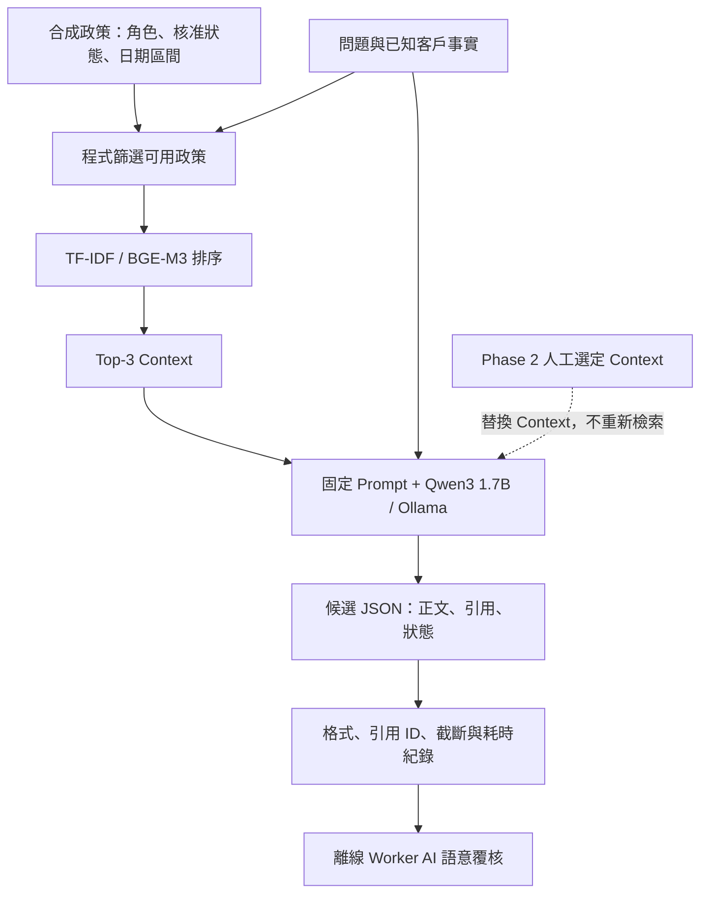

# CS07｜找到正確政策，為什麼 AI 還是答錯？

> **Engineering Deep Dive** · 客服 RAG · CS07  
> **研究狀態：** Research Closed · Worker AI Review · Human Acceptance PENDING  
> **研究範圍：** 13 份合成政策文件、24 題政策問答；本機離線實驗，未連接真實客戶、訂單、退款或客服系統。

客服 RAG 的直覺很簡單：先找出相關政策，再交給語言模型回答。但如果系統已經找到正確的退款期限，模型為什麼仍然可能答錯？

CS07 從檢索、Prompt、Context 到候選回答，逐步隔離變因，檢查「找到證據」與「正確使用證據」之間的落差。以下是既有工程研究的公開技術整理；沒有為網站新增實驗、重跑推論或進行獨立驗證。

## 研究摘要｜四個關鍵觀察

| 觀察 | 實驗結果 | 代表什麼 |
| --- | --- | --- |
| 檢索找回更多必要證據 | TF-IDF Recall@3 **92.5%**；BGE-M3 **97.5%** | 證據更常進入 Top-3，不等於模型能正確使用 |
| Prompt 改寫後，嚴格聯合通過數增加 | P0 **3/48**；P1 **7/48** | 改善集中於適當停止；「正文正確且有支持」沒有增加 |
| 人工選擇 Context 未改善主比較 | 原 Top-3 **1/15**；Oracle Context **1/15** | 排除部分檢索干擾後，生成問題仍存在 |
| 模型的狀態標籤與正文可能矛盾 | Q24 標記 `REVIEW`，正文仍承諾無依據的全商品退款 | 自行標記待覆核，並不等於有阻止交付的機制 |

**核心發現：** RAG 不能只用檢索命中率判斷是否可靠。正確政策進入 Context、模型引用了政策，甚至模型自行標記 `REVIEW`，都不能單獨證明回答正確或可安全交付。

這些觀察只適用於本次合成資料、模型與保存的實驗條件，不是對所有 RAG 系統的通用效能結論。

## 01｜系統架構與實驗流程

政策依原有 section 切分，保留 ID、標題與原文。程式先按角色、`approved` 狀態與適用日期篩選，再將合格片段排序，取出 Top-3。已知日期才套用對應日期區間；日期未知時，保留可能適用的版本。

模型接收問題、已知客戶事實與政策 Context，輸出包含正文、引用與 `ANSWER / CLARIFY / REVIEW` 狀態的 JSON。程式紀錄格式、引用 ID、截斷與耗時，之後進行離線語意覆核。**這個研究系統沒有自動向客戶發送回答，也沒有已實作的語意交付 Gate。**

比較檢索方法時，政策切分、資格篩選、Prompt 與生成模型保持相同。BGE-M3 在此使用 dense 向量及餘弦相似度，並未使用其全部能力，也沒有向量資料庫。模型以保存的 digest 識別；本研究沒有證明這是最優模型或架構。

## 02｜檢索更準確，為什麼仍然答錯？

**研究問題：** 如果更多必要政策進入 Top-3，是否足以讓模型回答正確？

| 檢索方法 | 必要證據 Recall@3 |
| --- | ---: |
| TF-IDF | 92.5% |
| BGE-M3 | 97.5% |

*Recall@3* 在這裡衡量：評估所需的政策證據，有多少被取回到前三個 Context 片段中；它不是回答正確率。

BGE-M3 的必要證據 Recall@3 較高，但生成結果仍出現明確反例：模型引用十四日政策，回答卻變成七日；或已取回配送政策，卻回答退貨問題。Q16／BGE 還出現輸出截斷，留下不完整 JSON；研究將它記為 **Execution Failure**，沒有補跑或補寫成成功答案。

**本節結論：** 檢索與生成需要分開評估。這組結果支持「必要證據更常被找回」，不支持「端到端客服回答因此可靠」。它也不能證明所有 Embedding 方法無效、檢索已達生產標準，或換模型就一定能解決問題。

*研究對應：Round 1–2 檢索結果與 Round 2 語意覆核；Q16／BGE。*

## 03｜更詳細的 Prompt，改善了什麼？

Round 3 Phase 1 固定已保存的 **48 份 Context**，比較原始 Prompt **P0** 與通用改良版 **P1**。P1 加強問題對準、條件保留，以及回答狀態與正文的一致性；沒有針對特定題號植入答案。

| 指標 | P0 | P1 |
| --- | ---: | ---: |
| Strict joint | 3/48 | 7/48 |

**Strict joint** 是本研究保存的嚴格聯合評分指標。它不是一般的回答正確率，也不能直接當成「回答正確且有證據支持」的數量。原始 L3 並未完整列出它的逐項判定規則，因此本文只引用保存的通過數，不自行補寫正式定義。

乍看之下，P1 的 Strict joint 通過數由 3 增至 7。但拆開結果後，新增成功集中在**應該停止時有適當停止**的案例；「正文正確且有證據支持」的數量沒有增加。同時，P1 Prompt 更長，請求成本也上升。

**本節結論：** 更詳細的指令對部分停止行為有幫助，卻不能把 3/48 到 7/48 解讀為整體生成可靠性提升。本研究也未建立 P1 的成本效益，沒有足夠證據自動以 P1 取代 P0。

*研究對應：Round 3 Phase 1，48 份保存的 Context，P0／P1 對照。*

## 04｜只給正確政策，AI 為什麼仍會答錯？

如果錯誤不是單純因為檢索漏掉政策，那麼先替模型選好 Context，結果會不同嗎？

Round 3 Phase 2 回到 P0，比較原始 Top-3 與事前人工選定的政策 Context，並另外觀察 Context 順序、噪音與相同 Payload 的重複執行。這是 **Oracle 診斷**：研究者人工選擇 Context 以定位問題，**不是**一個已完成的自動 Context Selection 系統。

| Phase 2 結果 | 保存結果 |
| --- | ---: |
| 嘗試執行 | 42/42 |
| 完成執行 | 41/42 |
| 主比較 Strict joint：原 Top-3 | 1/15 |
| 主比較 Strict joint：Oracle Context | 1/15 |

主比較沒有顯示 Strict joint 改善。更值得看的是三個具體反例。

### Q03｜十四日政策，仍回答七日

人工已選出正確政策，甚至只留下單一正確段落，模型仍把十四日期限答成七日。這削弱了「只是其他退款段落造成干擾」的解釋，但不能據此確定模型內部的失效機制。

### Q13｜第八天，被判成符合七日期限

正確政策已提供，模型仍把第八天判為符合七日期限。**能引用政策，不等於能正確計算或套用政策條件。**

### Q21｜Context 的噪音與組成會改變回答

系統取回配送相關內容，模型卻可能跟著退貨噪音回答；替換噪音後，回答可能轉向取消；補回缺失證據後，仍可能自行預設預購情境。

這說明 Context 組成確實可能影響生成。但研究也觀察到**相同 Payload 產生不同回答**，甚至一次截斷、一次完成，因此不能把單次輸出差異全歸因於 Context 順序或噪音。

**本節結論：** 人工挑選 Context 在部分案例有改善，也有退步；主比較維持 1/15。這不代表所有 Context Selection 方法無效，也不能據此斷言更大的模型必然能修復問題。

*研究對應：Round 3 Phase 2，主比較 15 組；Q03、Q13、Q21 與重複輸入觀察。*

## 05｜標記 REVIEW，為什麼仍出現退款承諾？

Q24 的保存輸出顯示一種不同的錯誤：模型在狀態欄位標記 `REVIEW`，正文卻仍做出缺乏依據的**全商品退款承諾**。

這是離線候選回答中的矛盾，**不是已經發生的真實退款**。本研究也沒有觀察到真實客戶資料外洩、未授權退款，或內部文件實際進入公開 Context。

| 工程環節 | 已實作／已觀察 | 尚未具備 |
| --- | --- | --- |
| Context 資格 | 依角色、核准狀態、日期篩選 | 角色登入驗證、受保護的來源核准流程 |
| 引用 ID | 離線檢查引用是否屬於當次 Context | 驗證正文每項主張都受政策支持 |
| 回答狀態 | 模型輸出 `ANSWER / CLARIFY / REVIEW` | 獨立交付決策 Gate |
| 語意支持 | 事後 Worker AI 覆核 | 線上主張驗證或獨立人工核准 |
| 人工處置 | 保存待裁狀態與研究紀錄 | 真實工單、責任人交接與發布流程 |

**本節結論：** 模型自行產生 `REVIEW`，並不會自動阻止正文中的錯誤承諾。若未來連接真實客服，哪些主張能由程式核對、哪些需要授權人確認，都必須另行設計並驗證。本次沒有完成這項交付控制。

*研究對應：Q24 保存的候選輸出與 Round 2 語意覆核。*

## 06｜我們如何評估結果，又有哪些限制？

CS07 不只研究模型回答，也檢查評估方式本身的限制。

### Gold 答案也可能有歧義

Q05 的簡潔安全處置，可能只需要付款政策；Q21 的合理追問，也未必需要兩段政策引用。獨立 AI 複審指出原 Gold 的歧義。研究**保留原 Gold 與原分數**，另外在語意 Rubric 中區分內容、證據支持、行為與任務處理，沒有事後修改分數讓結果變好。

### 如何盡量隔離變因

| 實驗階段 | 固定條件 | 主要改變 |
| --- | --- | --- |
| Round 2 | 政策片段、資格篩選、Prompt、模型 | 檢索方法 |
| Round 3 Phase 1 | 已保存 Context、同期比較條件 | P0／P1 Prompt |
| Round 3 Phase 2 | P0 | 人工選定 Context、順序、噪音及重複執行 |

JSON 截斷、Schema／執行失敗與退步案例都保留，不補跑成成功樣本。

### 可追溯，不等於獨立驗證

研究保存原始請求與回應、模型 digest、執行紀錄及版本核對資訊，支持相對一致性與追溯檢查。但 Worker 參與研究執行與回顧，Phase 2 Oracle Context 也由 Worker 選定；沒有獨立帳號、不可變日誌或獨立信任根。因此，不能把 SHA-256 或 Worker Review 當成全面獨立驗證。

### 尚未量測的現實問題

本次沒有真實客服流量、服務延遲、總成本、人工覆核成本或實際 ROI 的驗證，也沒有真實客戶交付。研究已結案，不代表完成生產環境驗收；**Human Acceptance 仍為 PENDING**。

*研究對應：Gold 歧義複審 Q05／Q21、Round 2、Round 3 Phase 1／2、CS07 結案紀錄。*

## 結語｜找到正確來源，不等於能正確回答

CS07 的實驗把一個看似單純的 RAG 問題拆成數個不同環節：政策是否被取回、模型是否正確使用政策、Prompt 是否改善任務處理、Context 是否影響結果，以及候選回答是否具備可交付條件。

結果沒有指向一個萬用修補方法：BGE-M3 提高了必要證據 Recall@3；P1 改善部分停止行為；人工選擇 Context 未提高主比較 Strict joint；模型的 `REVIEW` 狀態也可能與正文矛盾。

**這次真正確立的是診斷邊界，而不是生產解法。** 對這批合成政策問答，單看檢索命中、Prompt 指標或模型自述狀態，都不足以判定端到端回答可靠。

---

### 研究資料與公開範圍

本文依既有 CS07 工程研究與保存的實驗紀錄整理，未新增實驗或獨立驗證。各節的「研究對應」用來指出結果來自哪一輪、哪個反例，並非可點擊的公開原始資料連結。原始程式、Prompt、逐題輸出、Gold 評估、執行環境與覆核紀錄保存在本機研究專案，**不隨公開網站發布**。因此讀者可檢視本文揭露的方法、彙總結果與反例，但目前無法透過網站獨立取得原始資料重現全部實驗。

**研究狀態：** Research Closed · Worker AI Review · Human Acceptance PENDING。
