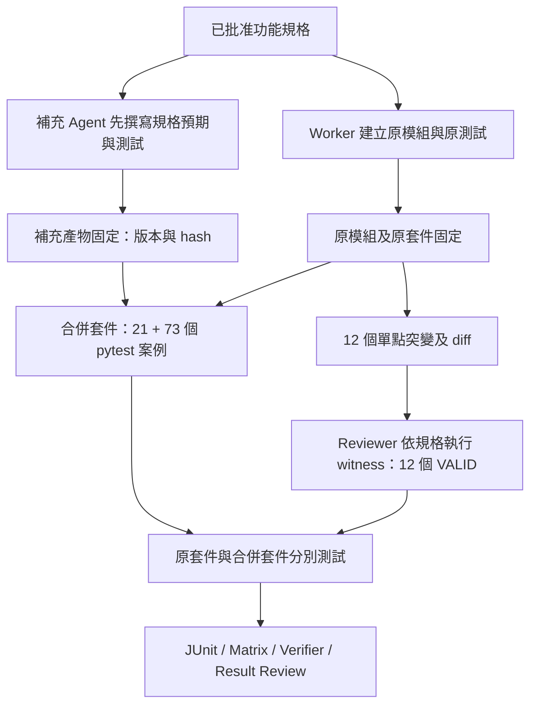

# DEV04｜測試全部通過，為什麼還是漏掉錯誤？

**Engineering Deep Dive · 軟體測試 · DEV04**

**研究狀態：** Round 1 完成 · Human Final Acceptance PENDING  
**研究範圍：** 記憶體內庫存保留／取消模組、12 個人工設計且經 witness 確認有效的單點突變；不是生產事故。

一套測試全部通過，是否代表程式沒有錯？DEV04 故意在正確的庫存模組中植入 12 個單點錯誤，讓原測試與新增測試在**同一批固定突變**上比較。真正值得追問的，不只是多抓到幾個錯誤，而是**為什麼原本已有的測試會放過它**。

## 研究摘要｜四個關鍵觀察

| 觀察 | 保存結果 | 代表什麼 |
| --- | --- | --- |
| 新增測試多抓到一個突變 | 原套件 **11/12**；合併套件 **12/12** | 對這批固定突變，檢出增加 8.33 個百分點 |
| 測試數量大幅增加 | **21** 項變成 **94** 項 | 不能單憑這組比較把效果歸因於「第二個 Agent」 |
| M12 揭露預期值污染 | `deepcopy` 被改成 `dict.copy()` | 測試用來比較的「正確值」也跟著被修改 |
| 分離不等於完全獨立 | 有交付順序與版本證據 | 共用工作區，沒有 OS 權限隔離 |

**核心發現：** 測試是否執行過某個操作，與測試是否具有**不受待測錯誤污染的預期值**，是兩件事。


## 01｜實驗設計：用固定突變比較兩套測試

｜從固定規格到突變檢出



**比較對象。** 原套件有 21 項測試；補充 Agent 提供 73 項 pytest 案例，合併後為 94 項。原模組通過原套件、補充 Agent 預先列出的 11 步規格預期及合併套件。測試案例數不等於其中的操作步數。

**比較規則。** 兩套測試與 12 個突變在正式比較前固定；只有測試斷言失敗算作 `Killed`，收集／匯入錯誤與 Timeout 必須另列。本輪沒有 Invalid、Equivalent、Timeout 或執行錯誤。所有突變均有 diff，並由不同 Reviewer 依規格產生操作預期、執行 witness，確認確實違反規格。

**研究對應：** 實驗設計與工程流程。

## 02｜新增 73 項測試，實際多抓到什麼？

｜兩套測試到底多抓到什麼？

**Engineering question.** 新增補充測試後，對同一批固定錯誤的檢出有何差異？

| 比較項目 | 原套件 | 合併套件 |
| --- | ---: | ---: |
| 原模組通過的 pytest 案例數 | 21 | 94 |
| Killed／有效突變 | 11／12 | 12／12 |
| Survived | 1 | 0 |
| 對這 12 個突變的檢出率 | 91.67% | 100% |

**Observed｜已觀察。** 合併套件多抓到 **M12** 這一個突變，增加 **8.33 個百分點**。檢出率分母始終是 12 個有效突變，不是 94 項測試。另行 Verifier 從 26 份原始 JUnit 重建結果及分母，Result Review 再檢查原始證據。

**Interpretation｜有限推論。** 這支持「額外測試對這批突變提供一個新增檢出」，但不能單獨證明「多一個 Agent」造成改善，因為同時增加了 73 個測試案例與準備投入；沒有與同一 Worker 自行補測試的對照組。

**研究對應：** 比較矩陣、JUnit 重建與 Result Review。

## 03｜M12：為什麼深拷貝測試仍放過淺拷貝？

｜M12：為什麼測到深拷貝，仍然沒有抓到淺拷貝？

**Engineering question.** 已存在名為 `test_snapshot_is_a_deep_copy` 的測試，為何沒有攔住 snapshot 的可變狀態洩漏？

### 單點突變

```python
# 正確原模組
return deepcopy(self._orders)

# M12：刻意引入的錯誤副本
return self._orders.copy()
```

`dict.copy()` 只複製外層訂單表；內層每筆訂單字典仍共享參照。因此修改 snapshot 內某筆訂單的 `quantity`，會改動庫存物件內部狀態，違反「修改回傳 snapshot 不得改變物件」的規格。

### 原測試為何誤放行？

原測試先從 snapshot 取得 `before`，再取得 `changed`，修改 `changed` 內層 `quantity`，最後比較物件 snapshot 與 `before`。

**Observed｜已觀察。** 在 M12 下，`before` 同樣指向共享的內層字典。修改 `changed` 時，**實際狀態與預期值一起被改壞**，兩者仍相等，測試因此通過。這不是沒有寫測試，而是測試的預期依據也受到待測錯誤污染。

### 補充測試如何攔住？

補充測試先對預期狀態另做 `deepcopy`，再修改 snapshot 的外層與內層。預期狀態不再跟著變動，因而偵測到違規：**合併套件在 M12 上 1 項失敗、93 項通過**。

**Engineering finding.** 測試是否涵蓋某個操作，和測試是否有獨立可靠的預期值，是兩件不同的事。

**Boundary｜不能推論。** 原模組原本正確；M12 是故意修改的研究副本。這不是正式庫存事故，也沒有證據證明原測試盲點由「同一 AI 撰寫程式與測試」這個因素造成。研究沒有在看到 M12 後修補測試再重算成績。

**研究對應：** M12 diff、原測試、補充測試與執行輸出。

## 04｜第二個 Agent 的獨立性到哪裡？

｜第二個 Agent 的「獨立性」實際到哪裡？

**Engineering question.** 補充 Agent 在沒有先看 Worker 實作的情況下準備測試，是否等於獨立驗證？

| 觀察維度 | 實際安排 | 能支持的範圍 |
| --- | --- | --- |
| 上下文 | 補充 Agent 以 `fork_turns="none"` 啟動，先讀功能規格 | 與 Worker 的對話上下文分離 |
| 模型 | 補充 Agent 使用 GPT-6.1-Sol、medium；與 Worker 同模型 | **不是**不同模型的獨立比較 |
| 交付 | 補充測試與預期先固定，提交位置、版本及 hash | 可核對交付先後順序 |
| 讀取時點 | Worker 在固定原模組與兩套測試後才讀補充內容 | 可見紀錄支持該工作順序 |
| 權限 | 共用工作區、同一環境 | **不是**帳號或檔案權限隔離 |

**Observed｜已觀察。** 可見工具紀錄與父執行紀錄支持補充內容先形成、後被 Worker 讀取的順序；補充 Agent 沒有把測試案例內容直接回傳給 Worker。

**Limitations｜證據限制。** 共用工作區仍可讀取，紀錄不可視為不可竄改的監視系統；不同上下文不保證認知盲點獨立。這是**有順序證據的上下文與交付分離**，不是完整獨立審查制度。

**研究對應：** 補充 Agent 交付順序、工具紀錄與基準 Freeze。

## 05｜怎麼確認抓到的是有效錯誤？

｜如何避免把無效突變或執行錯誤算成成功？

**Engineering question.** 突變測試的分母與 `Killed` 判定如何維持可追溯？

**實際採取的步驟：**

1. 依固定功能規格建立 12 個單點突變，每個保留差異檔。
2. 比較前由不同 Reviewer 對每個突變自行推導預期操作，再執行 witness，確認 12 個均違規且分類 `VALID`。
3. 固定兩組測試與突變清單後，對每個副本執行兩套測試。
4. 僅將測試斷言失敗記為 `Killed`；執行錯誤、Timeout、Invalid 與 Equivalent 另行區分。
5. 從原始 JUnit 重建結果，再進行 Result Review。

**Observed｜已觀察。** 這輪 12 個突變均有效，沒有 Timeout、執行錯誤、Invalid 或 Equivalent。Verifier 與 Review 支持保存結果的相對一致性。

**Limitations｜證據限制。** 12 個突變由 Worker 手工選定，不能據此證明選樣代表真實缺陷分布，或不存在選樣偏向。Verifier 核對保存結果，也不等於所有環節均有獨立權限隔離。

**研究對應：** 突變清單、witness、Verifier 與 Result Review。

## 06｜12/12 的檢出率能代表什麼？

｜100% 檢出率與執行成本，究竟代表什麼？

**Engineering question.** 這次測試結果能支持多少外推，額外測試又增加多少可觀察成本？

| 保存的本機執行資訊 | 結果 |
| --- | ---: |
| Python | 3.13.6 |
| pytest | 9.2.0 |
| 原套件測試 12 個突變的 pytest 程序總時間 | 約 12.681 秒 |
| 合併套件測試 12 個突變的 pytest 程序總時間 | 約 17.222 秒 |

**Observed｜已觀察。** 兩組時間包含子程序啟動，合併套件在這批執行中耗時較長。研究沒有安裝新工具或呼叫付費 API。

**Not measured｜未量測。** Agent Token、人力、尖峰記憶體、企業節省與真實導入 ROI 均未知；上述程序時間不是服務延遲，也不是受控效能實驗。

**Interpretation｜有限推論。** `12/12` 只代表這 12 個事前固定且經 witness 確認的錯誤全部被合併套件抓到，**不代表所有可能的程式錯誤都能被抓到**。研究沒有比較「不同 Agent」與「同一 Worker 補更多測試」的因果效果。

**研究對應：** 環境紀錄、pytest 程序時間與評分摘要。

## 結語｜全綠測試不等於沒有盲點

合併套件對 12 個事前固定、經 witness 確認有效的突變全部檢出，原套件漏掉 M12。M12 最有價值的地方，是讓人看見：**測試的預期狀態若與被測物件共享參照，即使斷言通過，也可能完全沒有驗證到想驗證的事**。

這輪沒有證明多 Agent 一定優於單 Agent，也沒有測試真實缺陷分布、不同模型組合或企業導入成本。**12/12 是這批突變的結果，不是對所有程式錯誤的保證。**

## 研究資料與公開範圍

本文依 DEV04 Round 1 的規格、突變 diff、witness、JUnit、結果重建與 Review 紀錄整理，未新增突變或重跑測試。原始測試程式、逐項結果與版本紀錄留在本機，不隨網站發布；公開內容可說明方法與主要反例，但不足以讓外部讀者獨立重現全部結果。**Human Final Acceptance PENDING。**
