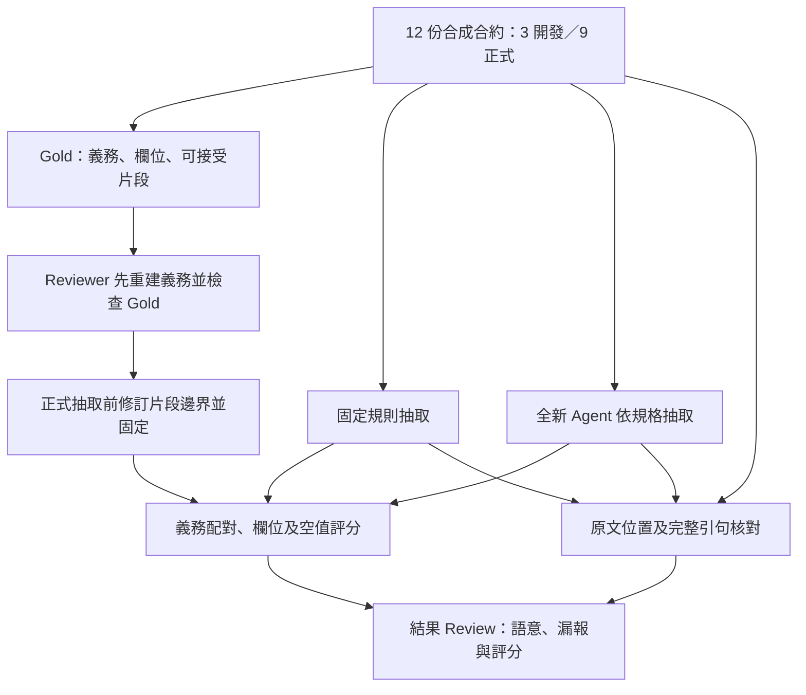

# L06｜抽取結果都是 100%，怎麼知道評分沒有錯？

**L3 · Engineering Deep Dive**

**研究範圍：** 12 份中文合成合約；正式測試 9 份、18 筆義務。規則法與 Agent 在固定測試上均達 100%，但 Gold 的接受邊界與引用語意仍需分開檢查。

**狀態：** 既有研究整理；Human Final Acceptance PENDING。本文沒有新增實驗、重跑測試或獨立驗證。

## 研究發現｜先看結果

| 觀察 | 保存結果 |
| --- | --- |
| 兩種抽取方法都達標 | 義務 F1 及 Recall 均 100%；適用欄位 60/60 |
| Gold 曾需要修訂 | 9 筆例外片段邊界與 T05 action 接受範圍修正 |
| 字串存在不等於意思正確 | 「不得揭露名單」刪去「不得」的刻意測試反例 |
| 資訊隔離有界線 | 正式 Agent 未收到 Gold，但共用工作區 |

## 01｜從合約原文到可核對的抽取

**比較對象。** 規則法使用固定的義務語氣、期限句型、條件與例外切分；Agent 依相同合約全文與欄位定義自行抽取。這是**規則流程與 Agent 流程**的比較，不是兩個 LLM 的效能比較。程式負責序列化與來源核對，沒有替 Agent 用規則補答案。

**關鍵區分。** `Gold` 是供評分的義務與欄位標準；「欄位可接受片段」允許保留完整事實的原文變體；「完整引句」則要求逐字相等。這三者不可混為同一種驗證。

## 02｜Gold 為什麼不是天然正確？

｜Gold 不是天然正確：9 個例外片段為什麼要修訂？

**Engineering question.** 如果模型抽取的片段保留了完整例外事實，卻比 Gold 短，應該判錯嗎？

**Observed｜已觀察。** Reviewer 先從 12 份原合約獨立重建義務，再核對 Worker 的 Gold。24 筆義務、120 個標準欄位及完整引用一致；但有 **9 筆例外**的可接受片段範圍過窄：較短、仍保留完整例外事實的原文片段會被拒絕。另有 T05 的一個 `action` 接受了整個義務語氣包裝，不符合「核心動詞＋受詞」的欄位定義。Reviewer 最初判定 `NEEDS_REVISION`。

**Engineering intervention｜實際修訂。** 在正式抽取之前，採用 Reviewer 事先固定的原文片段變體，並移除 T05 不符合定義的包裝。**未改動合約、標準欄位或事前 90% 門檻**；保留舊 Gold、差異與重核結果。重核狀態為 `PASS`。

**Interpretation｜有限推論。** 這次修訂是讓評分邊界更符合已定義任務，**不是讓抽取器變準**。沒有執行「舊 Gold vs 新 Gold」的模型成效對照，不能量化修訂對正式分數的影響。

## 03｜引句存在，為什麼仍可能改變義務？

｜引句在原文裡，不代表義務意思沒有被改掉

**Engineering question.** 字串核對能保證多少來源忠實度？

**Observed｜已觀察。** 最初的來源核對會先移除引句中的標點及空白再比對，卻將結果描述成「逐字引用」。Reviewer 指出不一致後，程式改成**完整引句逐字相等**，並加入拒絕刪改標點的測試；舊版本保留。

**反例｜刻意構造的單元測試。** 把「**不得揭露名單**」改為「**揭露名單**」：後者的字串仍存在於原句，單純檢查來源子字串可能通過，但義務含義已經相反。

| 檢查層次 | 能證明什麼 | 不能證明什麼 |
| --- | --- | --- |
| 位置與完整引句核對 | 引句和指定來源位置可對應，完整引句逐字一致 | 抽出的責任、行為、條件或例外必然正確 |
| 欄位片段接受規則 | 候選片段落在事先確認的合理表達範圍 | 完整合約語意已全面理解 |
| 依 Gold 與原文的語意 Review | 在指定案例中檢查義務、漏報及欄位含義 | 未知合約或未測語言變體都能正確 |

**重要界線。** 「不得」被刪的例子是**程式測試刻意注入的反例**，不是正式 Agent 的錯誤，也不是正式 9 份合約的漏報案例。

## 04｜兩種方法都 100%，分母怎麼算？

｜正式測試雙雙 100%，分母如何避免誤導？

**Engineering question.** 義務抽取、欄位正確、空值及來源引用，是否被當成同一個成功率？

| 正式測試：9 份合約、18 筆義務 | 規則基準 | 全新 Agent |
| --- | ---: | ---: |
| TP／FP／FN | 18／0／0 | 18／0／0 |
| 義務 F1／Recall | 100%／100% | 100%／100% |
| 適用欄位正確 | 60／60 | 60／60 |
| 正確空值（另外報告） | 30／30 | 30／30 |
| 有效完整引用 | 18／18 | 18／18 |

**評分機制。** 義務以文件、條款、責任方及可接受動作進行一對一配對；重複抽取算 `FP`，漏報算 `FN`。欄位主指標只計匹配義務中實際存在的欄位；原本為空卻捏造內容視為錯誤。**30 個正確空值另列，不拿來墊高 60 個適用欄位的主分數。** Gold 非空欄位覆蓋率另行報告，避免只評已答出的部分。標記 `REVIEW` 不會讓候選免於評分。

**Observed｜已觀察。** 兩方法在這批固定資料上均達到事前義務 F1、Recall、欄位正確率至少 90% 及全部引用有效的要求；正式結果沒有漏報、捏造或條件／例外錯配。Reviewer 另以原合約及先前重建結果核對語意、漏報與評分，而非僅接受 Worker 摘要。

**Interpretation｜有限推論。** 兩種方法在這批小型、固定版型的合約上表現相同，**不能推論規則與 Agent 在真實合約上同樣可靠**，也不能用 100% 引用有效率取代語意可靠率。

## 05｜Agent 沒看到 Gold，等於獨立驗證嗎？

｜Agent 的資訊隔離與 Freeze，實際鎖住了什麼？

**Engineering question.** 如何讓正式 Agent 不直接取得 Gold，同時不誇大隔離與可重現性？

**Observed｜已觀察。** 開發與正式抽取使用各自全新的 Agent，設定 `fork_turns=none`；正式 Agent 只收到 9 份測試 packet，未交付 Gold、開發答案或規則實作。Worker 另保存正式指示、讀取與輸出收據。正式抽取前 Freeze **35 個檔案**，涵蓋可控制的輸入、規則、答案片段、指示與設定。Reviewer 曾因平台額度限制中斷，恢復後才繼續；中斷紀錄保留。

**限制。** `fork_turns=none` 與不交付 Gold 是流程上的資訊分離，不是不同帳號、獨立 Runtime 或受保護檔案權限；共享工作區仍可能被存取。底層模型版本與 Token 用量無法獨立確認，因此**不能說整個平台模型已鎖定**，也不能把本題與其他題使用不同模型的結果當作升級比較。

## 結語｜這輪研究能支持什麼？

這批固定、短篇、規整的合約上，規則與 Agent 都完成指定抽取；但「Gold 合理」「引用字串正確」「義務語意正確」與「流程隔離」不能合成一個 100%。未測真實複雜合約、PDF、履約管理與企業 ROI。

## 研究資料與公開範圍

本文僅整理原研究的保存結果與案例。原始資料、程式、測試輸出、逐筆紀錄與版本證據留在本機，**L4 不公開**；因此網站可閱讀研究設計與主要結果，但無法單憑本頁完整重現實驗。原研究的證據紀錄仍可供內部追溯。**Human Final Acceptance PENDING。**