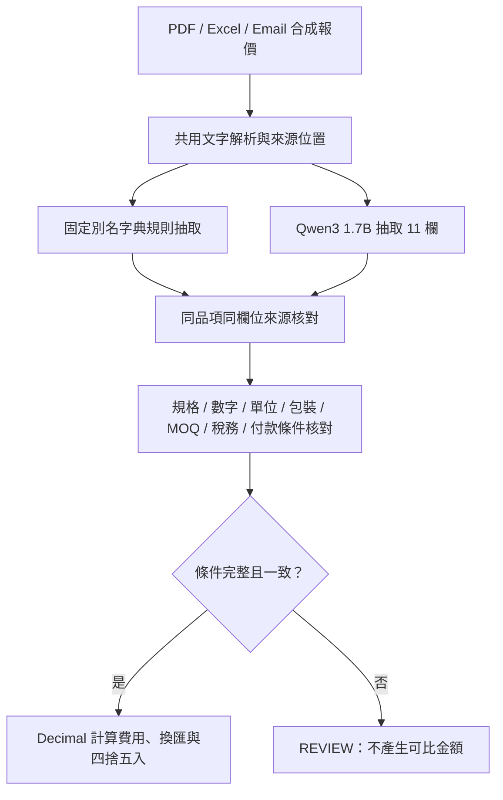

# P02｜抽取了報價，為什麼還是不能比較？

**Engineering Deep Dive · 報價比較 · P02**

**研究狀態：** 固定合成資料正式測試完成（2026-11-18）· Human Final Acceptance PENDING  
**研究範圍：** 30 份英文合成報價（PDF、Excel、Email 各 10 份），其中 21 份進入正式測試，共 63 個品項；未使用真實採購文件。

抽取出單價、運費與付款條件，看起來就能比較供應商報價。但**欄位抽得出來**、**數字有文件來源**、**整筆報價真的可比較**，其實是三個不同的問題。P02 同時測試規則抽取與本機 Qwen3 1.7B，讓兩者通過相同的來源核對與計算程序。

## 研究摘要｜四個關鍵觀察

| 觀察 | 保存結果 | 代表什麼 |
| --- | --- | --- |
| AI 抽取並未勝過規則基準 | micro F1：AI **88.07%**；規則 **100%** | 在這批規整的合成文件中，AI 沒有抽取優勢 |
| 抽取分數不等於可比較率 | AI **5/63**；規則 **18/63** | AI 對原本可比較的 18 列誤擋 13 列 |
| 沒有錯誤放行 | 兩者對 45 列不可比品項均為 **0** 誤放行 | 控制避免錯放，但 AI 覆蓋率很低 |
| 合法 JSON 也可能不可用 | 初版三份 PDF 開發樣本均無法進入比較 | 格式正確不等於欄位與來源正確 |

**核心發現：** 嚴格核對可以擋住缺來源、缺條件的候選值，但不能把「沒有錯放」當成整體成功；過度阻擋同樣會讓工具失去實用性。

## 01｜系統架構：從報價文件到可比較金額

｜從文件到可比較金額

本輪比較的是**規則抽取**與**Qwen3 1.7B 抽取**，兩者共用文件解析與後續核對／計算。30 份英文合成報價（PDF、Excel、Email 各 10 份；9 份開發、21 份正式測試），每份 3 個品項、每列 11 欄。正式測試有 63 個品項；固定詢價數量為 100 件，以假設匯率換算 TWD。

- **文件解析**：`pypdf` 讀取 PDF 文字並保留頁碼／抽出文字行號；`openpyxl` 讀取 Excel 欄名、值與儲存格；Email 按文字行定位。**未使用 OCR**，未測複雜視覺表格。
- **計算邊界**：商品費、一次性費與運費按固定業務假設處理；額外費用按每品項一次，採該列報價幣別。缺運費不可當零，包裝量未知不可猜，幣別衝突不可自行選擇。
- **權限邊界**：模型只提出欄位值，沒有工具執行權；來源核對與放行由程式處理，不讓模型自行決定可否比較。

**研究對應：** 實驗設計與工程流程。

## 02｜JSON 合法，為什麼欄位仍不能用？

｜合法 JSON 為何仍然完全不可用？

### 實際觀察｜初版結構正確、欄位角色錯置

最初的開發 Schema 要求模型逐欄輸出「值＋來源位置」。模型把兩個品項的值放進同一組配對；JSON 雖合法，已完成的三份 PDF 開發樣本中，品項均無法進入比較。**格式合法只能保證外形，不能保證值與來源位置的語意角色正確。**

正式測試前，研究將模型輸出簡化為**三個固定欄序的值陣列**，由程式尋找同品項、同欄位的唯一來源。找不到來源就保留錯值、留空位置並阻擋，不替模型修補答案。文件、成功門檻與來源核對沒有因此改變。

| 開發紀錄 | 原表示法 | 簡化表示法 |
| --- | ---: | ---: |
| PDF01 模型回報輸出 Token | 340 | 110 |

這只是兩次開發紀錄，**不是受控 Token 效率比較**；模型載入、快取與一筆中斷請求的紀錄缺口，都限制成本推論。

**研究對應：** 開發階段初版 Schema、PDF01 與抽取實作。

## 03｜缺運費時，為什麼不能直接填零？

｜沒有來源的值，為什麼不能「合理補零」？

### 實際觀察｜PDF02 缺運費，模型填 0

簡化 Schema 後，9 份開發樣本的 AI 抽取 F1 為 **90.60%**，但仍錯誤阻擋 5 列原本可比較的品項。PDF02 未提供運費，模型卻輸出 `0`；該值沒有同欄位來源，程式因此不允許進入計算。另有案例將稅務內容錯放至運費欄位。

這揭示兩個獨立檢查：

1. **來源存在性**：候選值是否能對應到同品項、同欄位的文件位置？
2. **業務可比性**：即使來源可找到，規格、包裝、MOQ、費用、稅務與付款條件是否足以支持指定數量的比較？

原文出現 `UNKNOWN`、`TO BE CONFIRMED` 或未解決的幣別，可以是**正確抽出的文字**，卻不是**允許計算的條件**。來源支持、欄位抽取正確與業務放行不能合併成單一成功率。

### 實際觀察｜PDF05 的數值巧合，不能直接當成因果

正式測試的 PDF05 缺單價，模型填入 `5.2`，與 Prompt 示例 `5.20` 數值相同。這是已保存的相符現象；**沒有移除示例的對照實驗**，因此不能宣稱示例造成模型填值。

**研究對應：** 開發評分、PDF02 缺運費與 PDF05 原始輸出。

## 04｜88.07% 的抽取 F1，為什麼只放行 5 列？

｜抽取 F1 與「可比較品項」為什麼差這麼多？

### 實際觀察｜正式測試的兩種不同分母

| 正式測試指標 | 規則基準 | AI＋共同核對 |
| --- | ---: | ---: |
| 抽取 micro F1 | 100% | **88.07%** |
| PDF／Excel／Email F1 | 100%／100%／100% | 89.37%／84.16%／90.67% |
| 可比且完成計算 | **18／63** | **5／63** |
| 原本可比但遭阻擋 | 0／18 | **13／18** |
| 原本不可比卻被放行 | 0／45 | 0／45 |
| 已放行品項金額錯誤 | 0／18 | 0／5 |
| 已放行欄位來源支持 | 198／198 | 55／55 |

63 列中，依 Gold **只有 18 列可比較**，其餘 45 列本就應阻擋。規則實際放行 18 列（佔全部 63 列的 28.57%）；AI 放行 5 列（7.94%）。AI 沒有錯誤放行不可比項目，但**漏放 13／18 列可比項目**。因此不能用「已放行的金額全部正確」掩蓋覆蓋率不足，也不能把全部 REVIEW 當成安全成功。

### 評分方式｜抽取 F1 怎麼算？

正式測試包含 **63 列 × 11 欄＝693 個欄位槽**，其中 **690 個 Gold 非空值**。非空值經正規化後精確比對；錯值同時計為 FP 與 FN，正確空值不靠 TN 拉高 F1。

AI 的保存統計：**609 個正確非空值、84 個錯誤／虛構非空值、81 個漏失／錯值對應 FN**，因此：

\[
\text{micro F1}=\frac{2\times609}{2\times609+84+81}=\frac{1218}{1383}\approx88.07\%
\]

**Inferred｜工程意義**：嚴格核對在這批資料上避免了錯誤放行，但也把模型抽取錯誤轉化為大量誤擋。這是安全性與覆蓋率的可觀察取捨，**不是**「AI 已具企業可用性」的證據。

**研究對應：** 正式測試評分與 Reviewer Gold 重建。

## 05｜來源核對器實際擋住了什麼？

｜共同核對器究竟驗證了什麼？

### 已實作的核對｜由程式決定能否進入 Decimal 計算

共同核對器要求欄位值能對上同品項、同欄位來源，並檢查規格、數字、單位、包裝、MOQ、稅務及付款條件；只有完整一致時才計算。13 項單元測試涵蓋缺值、錯誤位置、引用其他品項、非有限數、負費用與稅務差異等指定情境。

AI 最終只交付固定欄序的候選值，**不自行創造可信來源位置**；程式尋找唯一來源，無法定位就擋下。這比直接信任模型輸出的引用更有明確邊界，但仍有兩項限制：

- 核對器與規則基準**共用別名字典**；即使模型理解新寫法，核對器也未必允許通過。本輪沒有測試新表達泛化。
- 文件雖有 PDF、Excel、Email 三種格式，內容仍是規整的欄名—值；不能將格式數量等同真實文件複雜度。

### 執行與成本紀錄｜成本數字不可直接相比

21 份正式 AI 請求共記錄 **544.18 秒**、**17,508 輸入 Token**、**2,337 輸出 Token**，均正常結束且無截斷。規則抽取函式累計約 **0.00655 秒**。前者包含本機模型呼叫，後者只量抽取函式，**不是相同邊界的端到端速度比較**；人工標註、覆核與維護成本未測。

### 驗證邊界

不同 Agent 先由原文件重建 Gold，再核正式輸出；研究保存 96 份 Freeze 輸入與版本資訊，便於追溯，但不能防竄改。共同工作區、合成資料、未設 OS 權限隔離，也沒有第三方稽核。

**研究對應：** 來源核對、13 項指定測試、Freeze 與環境紀錄。

## 結語｜能抽取，不等於能比較

P02 的負面結果很清楚：在固定合成測試中，規則基準抽取 micro F1 為 100%，AI 為 88.07%，未達事前設定的 90% 目標。AI 沒有錯誤放行不可比品項，但也只放行 18 個原本可比品項中的 5 個。

這項研究的價值，不在於證明 AI 比規則好，而在於拆開四個判斷：**抽取是否正確、來源是否支持、條件是否可比、金額是否可計算**。對未知版型、OCR、真實採購資料、長期維護與 ROI，這輪都沒有驗證。

## 研究資料與公開範圍

本文依 P02 固定合成測試與保存的開發、正式評分、來源核對及覆核紀錄整理，沒有新增實驗。原始程式、逐筆輸出、Gold 重建、測試及 Freeze 紀錄留在本機，不隨網站發布；讀者可檢視公開的彙總數據與方法，但無法僅靠網站重現完整實驗。**Human Final Acceptance PENDING。**
