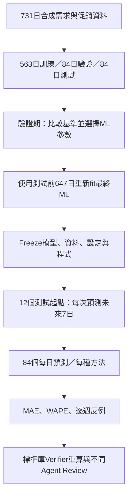

# S01｜需求預測誤差降低 47.78%，能證明模型比較好嗎？

**Engineering Deep Dive · 需求預測 · S01**

**研究狀態：** Round 1（2026-11-18）· 固定合成研究 · Human Final Acceptance PENDING  
**研究範圍：** 單一產品、731 天合成資料；每週預測未來七天，正式測試共 12 個起點、84 個每日預測／方法。

S01 的 ML 模型在正式回測中，MAE 比選定基準降低 **47.78%**。這個結果看起來很漂亮，但真正的工程問題是：**模型有沒有偷看到未來？比較雙方知道的資訊是否相同？整體勝出是否掩蓋局部失敗？**

## 研究摘要｜四個關鍵觀察

| 觀察 | 保存結果 | 代表什麼 |
| --- | --- | --- |
| ML 在指定測試中勝出 | MAE **5.2108**；選定基準 **9.9792** | 相對誤差降低 **47.78%** |
| 比較資訊不對稱 | ML 有日曆與已公布促銷特徵；基準只看歷史需求 | 不能把全部優勢歸因於 ML 演算法 |
| 並非每週都勝出 | **10/12** 週較好、**2/12** 週較差 | 整體指標會掩蓋局部退步 |
| 時間邊界有指定測試 | **10** 項 pytest 通過 | 只支持已測程式路徑，不能保證完全無洩漏 |

**核心發現：** 這輪支持的是**三個完整預測方案在指定合成資料上的比較**，不是「ML 演算法在公平同資訊條件下必然更好」。

## 01｜實驗流程：先固定資訊，再比較預測

本輪針對單一產品，每七天預測未來七天需求，使用兩個傳統基準與一個 `HistGradientBoostingRegressor`。最重要的工程邊界是：**預測時點能知道什麼，不能知道什麼**。其後才是模型選型、回測比較與結果驗證。

**研究對應：** 實驗設計與工程流程。

## 02｜預測未來七天，如何避免偷看未來？

｜七天預測如何避免看到未來？

### 研究問題
在一個週四起點預測未來七天時，如何防止後幾天的特徵偷偷使用預測起點之後才會出現的真實需求？

### 實作方式
採用**直接七日預測**：同一模型接收七列特徵，一次產生七個目標日的預測，而不是將第一天的真實結果逐日餵回後續天數。

- 對預測 horizon `h = 0…6`，上週同日的歷史來源為**起點前 `7−h` 天**，最晚只到起點前一天；四週同日平均也僅使用起點以前的歷史。
- 七日、二十八日 rolling mean 在**同一預測起點固定**，不隨 horizon 往未來移動。
- 未來可用資訊限日曆與**截至預測起點已公布**的促銷安排；公布日晚於起點的促銷不可當成已知。
- 下一週可以用新發生的真實需求更新輸入特徵，但不因此重新訓練模型權重。

### 實際觀察
10項 `pytest` 包含「修改未來需求，不應改變預測起點特徵」與促銷公布時間的邊界測試，均通過。這證明指定程式路徑與測試情境有檢查時間邊界，**不是**所有可能時間洩漏形式均已被排除。

**研究對應：** 時間邊界測試、預測程式與測試摘要。

## 03｜模型如何選型並在測試前固定？

｜模型與基準如何在正式測試前固定？

### 實驗設計
合成資料涵蓋2024–2025年共731日，包含週期、緩慢趨勢、每28日安排4日促銷與隨機波動；促銷提前14日公布。生成種子為`20261118`。資料依時間切分：

| 分區 | 天數 | 用途 |
| --- | ---: | --- |
| Train | 563 | 初始模型訓練 |
| Validation | 84 | 選擇基準與ML設定，12個互不重疊七日起點 |
| Test | 84 | 最終一次性評估，12個互不重疊七日起點 |

驗證期只比較兩組ML樹葉數設定：`7`與`15`，MAE分別為`5.2537`、`5.9248`，因此選`7`。兩個基準中，四週同日平均MAE為`9.8988`，優於上週同日的`14.0833`，因此作為正式主要基準。

### 測試前固定版本
選型完成後，**使用測試前647日資料重新fit最終模型**；接著保存模型、設定、程式、資料與檢查紀錄的版本及hash，才開始正式測試。測試期間沒有再fit。這裡的Freeze是本輪模型與輸入的固定紀錄，不是不可竄改的安全保證，也不是Memory Layer版本Freeze。

**研究對應：** 生成登記、選型結果、Freeze 與測試啟動紀錄。

## 04｜MAE 降低 47.78%，比較公平嗎？

｜MAE降低47.78%，能證明ML比較好嗎？

### 正式結果
正式測試涵蓋2025-10-09至2025-12-31；每種方法84個每日預測，三種方法共252列。MAE單位為每日需求量，WAPE為總絕對誤差除以總實際需求，**不是準確率**。

| 方法 | MAE | WAPE |
| --- | ---: | ---: |
| 上週同日 | 14.5119 | 12.31% |
| 四週同日平均（選定基準） | 9.9792 | 8.46% |
| ML | 5.2108 | 4.42% |

相對選定基準，ML的MAE降低`47.78%`，通過預先設定的`10%`工程門檻。這不是統計顯著性檢定；MAE與WAPE使用同一組真實需求，不能視為兩份獨立勝出證據。

### 比較限制：資訊不對稱
**比較的資訊並不對稱。** ML可使用已知促銷與日曆特徵，兩個簡單基準只使用歷史需求。本次證明的是**這三個完整方案在此資料上的表現差異**，而非純粹的「ML演算法相對於同等資訊規則」的效果。

- **Observed：** ML在本輪合成資料上優於兩個指定基準。
- **Inferred：** 額外特徵可能解釋部分優勢；現有比較無法拆分其貢獻。
- **Not tested：** 使用相同促銷資訊的確定性規則、不同種子或產品、真實需求資料，以及統計顯著性。

**研究對應：** 正式預測 CSV、測試分數與 Verifier 重算。

## 05｜整體勝出，哪些週仍然輸了？

｜整體勝出時，哪些錯誤仍然存在？

12個測試週中，ML有10週MAE優於選定基準，但仍有兩週較差：

| 測試週起點 | ML MAE | 四週同日平均 MAE | 觀察 |
| --- | ---: | ---: | --- |
| 2025-10-30 | 6.0162 | 5.6071 | ML較差 |
| 2025-11-27 | 5.2464 | 4.2143 | ML較差 |

最大的單日ML誤差發生於`2025-12-04`：實際需求`138`，預測`116.6369`，低估`21.3631`。

這些反例保留於正式輸出，沒有事後修改資料或模型。**整體通過10%門檻，不代表每週、每一天都比較好。** 研究也沒有將這些預測誤差轉換成庫存、缺貨、人力或財務損益。

**研究對應：** 逐週結果與單日最大誤差檢視。

## 06｜結果如何重算，還有哪些限制？

｜結果如何被重算，還有哪些驗證限制？

### 結果重算
Worker的評估程式與使用標準庫的Verifier分開。Verifier從原始CSV重新計算兩個基準、MAE、WAPE、逐週結果及10%門檻，並檢查起點、日期與Freeze內容。另由不同Agent閱讀原始CSV、批准標準及程式進行前置與結果Review。

**限制：** Verifier程式仍由同一Worker撰寫；Reviewer曾看過預期答案，也參與前置審查，不能稱盲審、第三方稽核或獨立權限隔離。

10項pytest通過，但產生1950項pandas舊日期屬性別名警告，屬未處理的相容性限制，不是斷言失敗。

### 執行紀錄
本機使用Python `3.13.6`、scikit-learn `1.9.1`、pandas `3.1.1`、NumPy `2.5.4`。選型及最終擬合約`3.262秒`；測試載入／預測／評分約`0.308秒`；模型檔`104576 bytes`。這些是單次程式內計時，未涵蓋程序啟動、套件匯入、尖峰記憶體、人力與Coding Agent Token，不能推算企業ROI。

**研究對應：** Verifier、前置與結果 Review、環境及執行紀錄。

## 結語｜漂亮的回測成績，需要清楚的比較邊界

S01 在這組合成資料上通過預先設定的 10% MAE 改善門檻，且保存了兩個 ML 表現較差的測試週與單日最大低估案例。時間資訊限制、測試前 Freeze 與結果重算讓這次比較更容易檢查。

但 ML 與基準使用的資訊不對稱；本輪沒有比較同樣使用促銷資訊的規則方案，也沒有跨產品、跨種子、真實需求或統計顯著性驗證。因此，**47.78% 是這次方案比較的結果，不是純演算法效果，也不是企業 ROI**。

## 研究資料與公開範圍

本文根據 S01 Round 1 的合成資料、選型、正式預測、測試、Verifier 與 Review 紀錄整理，未新增實驗。原始 CSV、程式、逐筆輸出及版本紀錄留在本機，不隨網站發布；公開文章呈現方法、彙總指標及反例，不能單靠網站重現完整回測。**Human Final Acceptance PENDING。**
