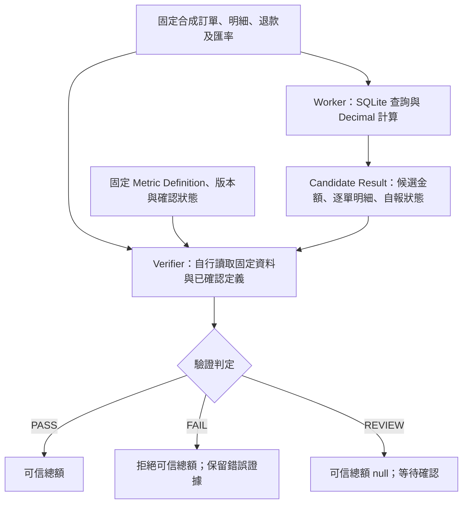

# VER02｜兩個程式算出同一金額，為什麼仍然可能都錯？

**L3 · Engineering Deep Dive**

**研究範圍：** 固定合成訂單淨額 PoC；11 個驗收情境。Worker 與 Verifier 的計算路徑分離，但由同一 Coding Agent 在同一環境撰寫；沒有真實會計或企業訂單驗證。

**狀態：** 既有研究整理；Human Final Acceptance PENDING。本文沒有新增實驗、重跑測試或獨立驗證。

## 研究發現｜先看結果

| 觀察 | 保存結果 |
| --- | --- |
| 同公式重算未發現五種故障 | 5/5 錯誤候選與弱 Baseline 一致 |
| 依業務定義驗證能拒絕故障 | 5/5 固定故障得到 FAIL |
| 11/11 符合預期 | 包含預期 FAIL 與 REVIEW，不是所有金額都正確 |
| Worker 自報 PASS 無效 | 由 Verifier 依固定定義與資料判定 |

## 01｜候選金額如何被核對？

這不是兩個 AI 互相審查。Worker 與 Verifier 都由同一 Coding Agent 撰寫，使用同一工作環境；**分離的是計算路徑與判定權威，不是作者或 OS 權限**。Verifier 不採信 Worker 附帶的定義、路徑或自報 PASS；它先核對固定定義與資料，再用 Python 逐單重算。研究範圍是 2026 年 11 月指定付款成功且未取消訂單的合成淨額，不是正式會計營收。

## 02｜同公式重算為什麼抓不到錯誤？

｜為什麼同公式重算抓不到業務錯誤？

**Engineering question.** 如果 Worker 漏掉退款，而 Baseline 也照 Worker 的篩選與公式再算一次，兩者一致是否足以放行？

**Implementation.** Round 1 事前固定兩條路徑：Baseline 僅重算 Worker 採用的公式／篩選；額外驗證器則另核對已確認的業務口徑、訂單狀態、日期範圍、明細粒度、退款截止點、幣別與逐單調節。日期按台北時區，期間為 2026-11-01 00:00（含）至 2026-12-01 00:00（不含）。金額使用 `Decimal`；每張訂單及其退款先依原訂單匯率換算、`ROUND_HALF_UP` 至小數兩位，再加總。

**Observed evidence.** 五種事前設計的故障，Baseline 都與錯誤候選一致；定義驗證器則全部拒絕：

| 固定故障 | 錯誤候選（TWD） | 同公式重算 | 定義驗證器 |
| --- | ---: | --- | --- |
| F01：納入取消訂單 | 640.00 | 一致 | FAIL |
| F02：明細 JOIN 重複加總 | 840.00 | 一致 | FAIL |
| F03：漏扣退款 | 520.00 | 一致 | FAIL |
| F04：混用原幣金額 | 208.00 | 一致 | FAIL |
| F05：扣除截止後退款 | 430.00 | 一致 | FAIL |

正常案例 F00 的可信總額是 **440.00 TWD**；精度案例 F06 是 **200.06 TWD**。

**Interpretation.** 數值一致只表示兩條路徑執行了相容的計算，不表示它們採用了正確業務定義。這五個故障是刻意注入，不是觀察到 AI 自然犯錯的頻率；Baseline 也刻意較弱，不能把 5/5 解讀成一般場景的效能提升。

## 03｜Worker 自報 PASS，為什麼不算數？

｜Worker 自報 PASS，為什麼沒有決策權？

**Engineering question.** 如果候選程式可以同時提供答案與「我已通過」的狀態，驗證器是否只是形式上的第二道關卡？

**Implementation.** `src/worker.py` 只產生候選金額與逐單資料；`src/verify.py` 從實驗 harness 固定位置讀取定義、資料與基準，先檢查完整性及確認狀態，再以獨立參照計算比對。`src/run_round2.py` 為 11 個固定情境建立各自 workspace，變體只改 outputs 複本，變體基準由 harness 建立，而非由 Worker 候選指定。

決策規則在 Round 1 事前固定：**確定 FAIL 優先，其次 REVIEW；全部必要檢查通過才 PASS**。FAIL／REVIEW 不輸出可信總額，仍可保留提交的候選金額供調查。

**Observed evidence.** 五個錯誤候選即使自報 PASS，仍得到 FAIL；正常命令列案例即使自報 FAIL，Verifier 仍依資料判為 PASS。缺 USD 匯率（G01）與未確認定義（G02）都得到 REVIEW，可信總額為 `null`。定義與基準不符（S02）時得到 FAIL，且停止參照計算。

**Interpretation.** 這裡的控制不是要求 Worker 更誠實，而是讓候選自報狀態不具有放行效力。但權威定義、基準與程式仍由同一帳號可讀寫；這是指定程式路徑的控制，不能稱為不可繞過的獨立信任根。

## 04｜11/11 通過，究竟是哪些情境？

｜11/11 通過，究竟通過了什麼？

**Engineering question.** 「所有測試通過」是指所有候選金額被接受，還是驗證器對正常、錯誤與未知案例做出預期處置？

| 測試類型 | 符合預期 | 實際支持的觀察 |
| --- | ---: | --- |
| Functional | 7/7 | 正常與精度案例 PASS；五個故障候選 FAIL |
| Security | 2/2 | 指定 SQLite 唯讀分析連線拒絕 INSERT 且 DB hash 不變；定義與基準不符即 FAIL |
| Governance | 2/2 | 缺匯率或未確認定義時 REVIEW，可信總額 `null`；Worker 自報 PASS 無效 |

合計 **11/11 固定情境符合預期**；`pytest` 為 **12/12**（11 個情境加 1 個整體核對），不是 23 個獨立實驗。這些結果源自 Round 2，Round 3 沒有重新執行或增加測試。

**Critical distinction.** 這個「通過」包含預期中的 FAIL 與 REVIEW；它不是所有候選金額都正確，更不是任意查詢、任意 SQL、完整系統權限或正式部署已驗證。SQLite `mode=ro` 與 `query_only` 限制指定分析連線，不阻止同 OS 帳號直接修改資料檔。

## 05｜可重算與獨立驗證差在哪裡？

｜可重算與可獨立驗證，是兩件事

**Engineering question.** 既然有原始資料、程式、hash 和外部複審回報，證據能支持到什麼程度？

**Observed.** Round 1 固定合成資料、指標口徑、11 個驗收情境與基準答案；Round 2 實作 Worker、Verifier、SQLite 連線與測試；Round 3 核對交付一致性、保留審查來源並停止執行，沒有修改原有程式或測試結果。算術交叉核對回報 **440.00 TWD PASS**，但審查者事先知道候選答案，盲審獨立性 **NOT ESTABLISHED**。

**Reproducibility boundary.** 原始執行產物、程式 SHA-256、固定情境與測試命令可供後續核對；但 hash 只證明相對基準的一致性，不證明基準本身正確或不可竄改。Worker、Verifier、資料、定義與測試由同一 Agent 編製，沒有 hidden holdout、強制角色分權或不可變日誌。

**Recorded runtime, not a benchmark.** 全情境約 **4142.24 ms**；功能情境 Baseline 重算合計 **21.12 ms**、Verifier 合計 **160.79 ms**。量測範圍不同，不能據此宣稱穩定速度倍數或淨 ROI；人力、訂閱分攤、電力與總成本未量測。

## 結語｜這輪研究能支持什麼？

VER02 的 Solved 僅限固定合成 PoC 與 11 個驗收情境。研究支持將候選金額與業務定義核對分開，不能證明驗證器具有獨立權限、不可竄改的信任根或正式會計適用性。

## 研究資料與公開範圍

本文僅整理原研究的保存結果與案例。原始資料、程式、測試輸出、逐筆紀錄與版本證據留在本機，**L4 不公開**；因此網站可閱讀研究設計與主要結果，但無法單憑本頁完整重現實驗。原研究的證據紀錄仍可供內部追溯。**Human Final Acceptance PENDING。**