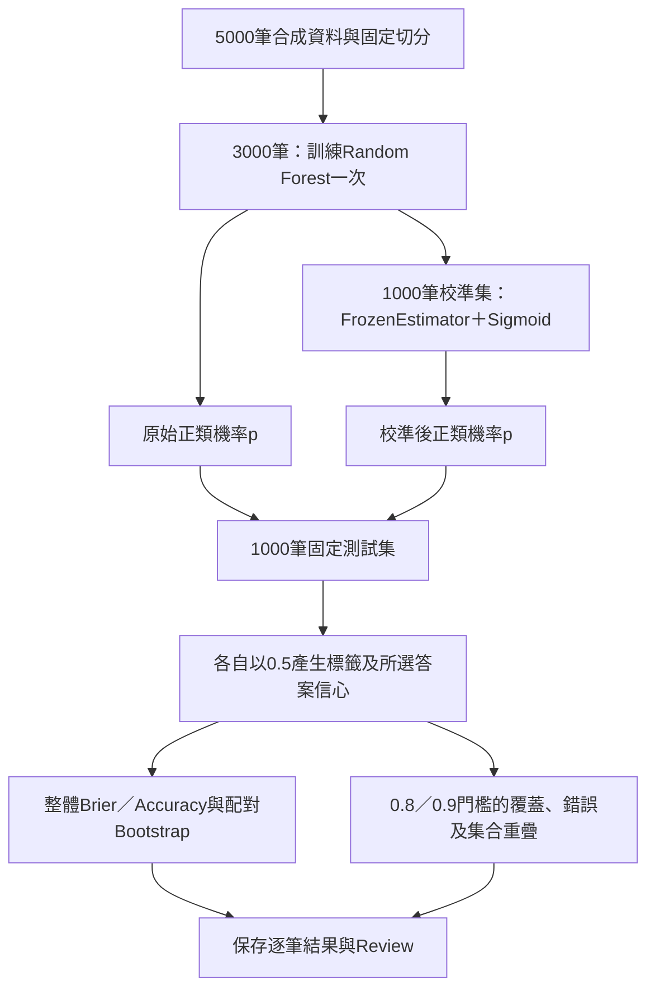

# VER06｜校準後高信心錯誤率降低，為什麼整體反而變差？

**L3 · Engineering Deep Dive**

**研究範圍：** 5,000 筆合成二元分類資料；3,000 筆訓練、1,000 筆校準、1,000 筆測試。比較同一 Random Forest 的原始機率與 Sigmoid 校準後機率，不是 LLM 自述信心。

**狀態：** 既有研究整理；Human Final Acceptance PENDING。本文沒有新增實驗、重跑測試或獨立驗證。

## 研究發現｜先看結果

| 觀察 | 保存結果 |
| --- | --- |
| 整體 Brier 變差 | 0.156486 → 0.161318；Δ +0.004832 |
| 分類正確數下降 | 763/1000 → 755/1000 |
| 0.9 高信心集合錯誤率下降 | 7.14% → 1.74%，但兩組只有 19 筆重疊 |
| 0.8 門檻方向相反 | 錯誤率 8.62% → 10.78% |

## 01｜實驗流程：同一模型的校準前後比較

同一個 Random Forest 先產生正類機率，再以獨立校準資料擬合 Sigmoid。比較的不是兩個重新訓練的分類器，而是**原始機率與校準後機率所形成的兩套決策輸出**。工程檢查須同時追蹤機率、0/1 標籤、所選答案信心、整體 Brier，以及門檻選出的樣本集合。

## 02｜同一個森林，校準為何改變答案？

｜校準如何改變機率，甚至改變分類答案？

### 研究問題
同一個 Random Forest 沒有重訓，為什麼校準後分類正確筆數仍從 763 降到 755？

### 實作方式
- 合成資料共 **5000筆**，由四個標準常態特徵、含線性與交互作用的正類機率及 Bernoulli 抽樣生成；固定生成種子 `20261118`，另以固定、與標籤無關的隨機切分得到 **3000 train／1000 calibration／1000 test**。
- Random Forest 固定 **200棵樹、最大深度5、葉節點至少10筆**，只訓練一次。
- 以 `FrozenEstimator` 包住已訓練森林，在**獨立1000筆校準集**上擬合 Sigmoid；校準時不重訓森林。
- 對兩方案分別使用自己的正類機率 `p`，以 `p >= 0.5` 判為1，否則判為0。所選答案的信心為：預測1時取 `p`，預測0時取 `1−p`。**正類機率、分類標籤、所選答案信心是不同欄位。**

### 實際觀察
| 同一1000筆正式測試 | 原始森林 | Sigmoid校準後 |
| --- | ---: | ---: |
| Brier（越低越好） | 0.156486 | 0.161318 |
| 分類正確率 | 76.3% | 75.5% |
| 正確筆數 | 763 | 755 |

校準後有**64筆標籤從0變1**：其中28筆由錯變對，36筆由對變錯，淨少8筆正確。保存的 Sigmoid 係數顯示，原始 `p` 約 **0.44465** 就可能映射到校準後的 `0.5`；這是機率映射造成決策邊界移動的解釋，**不是事後另選分類門檻**。

### 解讀與限制
同一基礎森林不代表同一分類結果。這次比較也多使用了1000筆校準標註，無法把校準演算法與額外資料投入的效果完全分離；沒有比較其他校準方法。

## 03｜Brier 變差，Bootstrap 支持什麼？

｜Brier 變差，配對 Bootstrap 究竟支持什麼？

### 研究問題
如何判斷整體 Brier 差異不是只看一個測試集點估計？又不能從這個區間推論什麼？

### 實作方式
Brier 以**正類機率 `p` 與實際0/1標籤**計算平方誤差，不是用所選答案信心與正確率替代。比較量固定為：

`ΔBrier = Brier(Sigmoid後) − Brier(原始森林)`

正式評估在同一1000筆測試資料上執行。**1000次配對 Bootstrap** 每次使用同一組抽樣索引分別計算兩方案 Brier，再相減；保存抽樣索引與每次分數。

### 實際觀察
- `ΔBrier = +0.004832`，正值代表校準後較差。
- 配對 Bootstrap 的 **95% 百分位區間 `[+0.001261, +0.008519]`**，整段大於0。
- 本輪固定模型、校準器與測試方案下，**沒有整體 Brier 改善證據**；反而觀察到較差的 Brier。

### 解讀與限制
這個區間只描述**固定模型／校準器下測試樣本抽樣**的不確定性，沒有包含重新訓練、換資料生成種子、改分布或其他模型選型。Brier 是整體機率品質指標，不能只因總分變差就宣稱每一個信心區間都惡化。

## 04｜高信心錯誤率下降，為什麼不能直接說更安全？

｜高信心錯誤率下降，為什麼不代表同一群案件更安全？

### 研究問題
校準後 `confidence >= 0.9` 的錯誤率從7.14%降到1.74%，是否表示高信心案件經校準後變可靠？

### 實作方式
先由每個方案自己的 `p` 產生預測標籤，再取**所選答案信心**，用事前固定的 `0.8`、`0.9` 門檻挑選樣本。對每個門檻同時核對：保留筆數、錯誤筆數、錯誤率、兩方案選取集合的交集，以及選取集合的類別組成。門檻不因結果調整。

### 實際觀察
| 信心門檻 | 原始：保留／錯誤 | 校準後：保留／錯誤 | 共同選中 |
| --- | ---: | ---: | ---: |
| `>= 0.8` | 406／35（8.62%） | 529／57（10.78%） | 400 |
| `>= 0.9` | 70／5（7.14%） | 115／2（1.74%） | 19 |

**0.9門檻的集合並不相同：** 原始選中70筆，其中預測0有52筆、預測1有18筆；校準後選中115筆，其中預測0只有1筆、預測1有114筆。兩組**只有19筆重疊**；原組51筆移出，另有96筆移入。

0.8門檻則呈現另一個方向：覆蓋率從**40.6%升至52.9%**，但錯誤率也從**8.62%升至10.78%**。不能只挑0.9門檻呈現成功。

### 解讀與限制
**Observed：** 固定測試下，0.9門檻的校準後選取集合錯誤率較低。  
**Not established：** 原本相同案件因校準而變安全、校準提升了所有高信心決策的品質，或此門檻可安全觸發自動行動。

此處的主要工程問題是 **selection effect（選取集合改變）**：信心映射與標籤移動同時改變了誰被選中，必須連同覆蓋率、錯誤代價及樣本組成解讀。

## 05｜可靠度圖究竟畫的是哪種機率？

｜可靠度圖究竟在比較什麼？

### 研究問題
當圖上出現「平均信心85%，實際正確率87%」，這是在檢查正類機率還是預測答案的可靠度？

### 實作方式
本輪主要可靠度圖採用**所選答案信心**分箱，再與該箱的**實際分類正確率**比較。這與「把正類機率分箱，再看實際正類比例」是兩種不同的校準圖，不能混用。圖中應保留每箱筆數，空選取點不能被畫成零錯誤。

### 實際觀察
- 校準後 `[0.8, 0.9)` 箱：平均所選答案信心約 **85.07%**，實際正確率 **86.71%**。
- 校準後 `[0.7, 0.8)` 箱：平均信心約 **75.70%**，實際正確率 **68.37%**。

**原研究圖表：** 固定測試下的信心可靠度、每箱筆數與風險覆蓋（原圖留存本機，未隨網站公開）。

### 解讀與限制
局部箱子的表現可與整體 Brier 不同方向，但箱內筆數與組成不可省略。圖上的線只連接有限測試格點，不是未觀測信心區間或部署風險的保證。圖片與 SVG 是**原研究產物**，網站公開前須確認路徑可存取。

## 06｜如何確認校準沒有重新訓練？

｜如何證明只校準，沒有重訓？

### 研究問題
`joblib.hash` 在序列化前後不同，是否就能判定森林被重訓？

### 實作與觀察
- 正式測試前固定資料、程式、模型／校準器、分箱、門檻、Bootstrap與前置Review；測試只執行一次。
- 在**同一進程**校準前後，森林的 `joblib.hash` 相同；但**序列化後重新載入**所得物件的 hash 不同。
- 這個差異被保留，沒有為讓 hash 相同而重訓或改寫產物。Reviewer另外檢查 `FrozenEstimator` 指向同一森林、200棵樹的訓練根節點筆數及參數；正式 Freeze 與測試後則比較**模型檔 SHA-256**。
- 10項 pytest 覆蓋手算 Brier、信心與標籤、0.5 平手、分箱邊界、空集合、配對索引、不合法機率及生成／ID分離。不同 Agent 另重算1000筆結果、各箱與1000次 Bootstrap。

### 解讀與限制
物件 hash 的跨序列化差異**不直接證明重訓**，同進程 hash 一致也**不是跨序列化恆等保證**。檔案 SHA-256 只核對指定保存產物的一致性；同帳號仍可接觸資料及檔案，沒有強制隔離、完全盲審或第三方稽核。

## 結語｜這輪研究能支持什麼？

本輪 Sigmoid 沒有達到整體 Brier 改善目標。0.9 門檻看似改善，但校準前後選中的不是同一群樣本；不能忽略集合組成、覆蓋率與其他門檻的負面結果。未測真實決策風險與企業 ROI。

## 研究資料與公開範圍

本文僅整理原研究的保存結果與案例。原始資料、程式、測試輸出、逐筆紀錄與版本證據留在本機，**L4 不公開**；因此網站可閱讀研究設計與主要結果，但無法單憑本頁完整重現實驗。原研究的證據紀錄仍可供內部追溯。**Human Final Acceptance PENDING。**